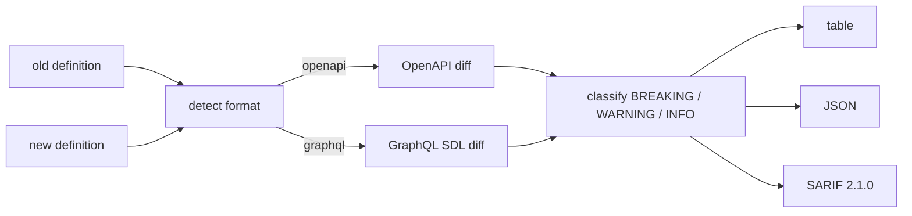

<a name="top"></a>
<div align="center">


# APIDIFF

### Breaking-change detector for OpenAPI / GraphQL across commits


[](https://pypi.org/project/cognis-apidiff/) [](https://github.com/cognis-digital/apidiff/actions) [](https://github.com/cognis-digital/apidiff/actions/workflows/ports.yml) [](LICENSE) [](https://github.com/cognis-digital)

*Developer Tools — fast, single-purpose, CI- and agent-friendly.*

</div>

```bash
pip install cognis-apidiff
apidiff diff openapi.old.json openapi.new.json   # → classified changes in milliseconds
```

`apidiff` compares two versions of an API definition and tells you, with a clear
severity (**BREAKING / WARNING / INFO**), exactly what changed and whether it
will break existing consumers. Point it at the baseline and the candidate in
your CI pipeline and it fails the build *before* a breaking change ships. It is
**dependency-free**, **offline**, and **read-only** — it diffs two files; it
never calls your API and never touches the network.


<!-- cognis:example:start -->
## 🔎 Example output

Real, reproducible output from the tool — runs offline:

```console
$ apidiff-emit --version
apidiff 0.6.0
```

```console
$ apidiff-emit --help
usage: apidiff [-h] [--version] {diff,mcp} ...

Breaking-change detector for OpenAPI / GraphQL across commits.

positional arguments:
  {diff,mcp}
    diff      Diff two API definitions
    mcp       Run the MCP stdio server (requires the 'mcp' extra)

options:
  -h, --help  show this help message and exit
  --version   show program's version number and exit
```

> Blocks above are real `apidiff` output — reproduce them from a clone.

**Sample result format** _(illustrative values — run on your own data for real findings):_

```
{
"findings": [
    {
        "id": "123456",
        "title": "Suspicious Network Traffic",
        "description": "Potential malicious activity detected on port 443",
        "severity": "medium",
        "labels": ["network", "traffic"],
        "created_at": "2023-02-15T14:30:00Z"
    },
    {
        "id": "789012",
        "title": "Unusual File Access",
        "description": "User accessed a file with unusual permissions",
        "severity": "high",
        "labels": ["file", "access"],
        "created_at": "2023-02-15T14:31:00Z"
    }
]
}
```

<!-- cognis:example:end -->

## Usage — step by step

`apidiff` detects breaking changes between two OpenAPI / GraphQL definitions.

1. **Install** (either way works today):
   ```bash
   pip install cognis-apidiff                                       # PyPI
   pip install "git+https://github.com/cognis-digital/apidiff.git"  # from source
   ```
2. **Diff a baseline against a candidate** definition:
   ```bash
   apidiff diff openapi.old.json openapi.new.json
   ```
3. **Force the format** when auto-detection is ambiguous:
   ```bash
   apidiff diff schema.old.graphql schema.new.graphql --fmt graphql
   ```
4. **Read the output** as JSON for tooling, or SARIF for code scanning:
   ```bash
   apidiff diff openapi.old.json openapi.new.json --format json
   apidiff diff openapi.old.json openapi.new.json --format sarif
   ```
5. **Automate in CI** — `--fail-on` controls when the diff returns a non-zero exit:
   ```bash
   apidiff diff openapi.old.json openapi.new.json --fail-on breaking
   ```

> **Input formats.** OpenAPI documents are read as **JSON** (OpenAPI 3.x or
> Swagger 2.0). If your spec is YAML, convert it first — e.g.
> `python -c "import sys,yaml,json; json.dump(yaml.safe_load(open(sys.argv[1])), open(sys.argv[2],'w'))" openapi.yaml openapi.json`
> — then diff the JSON. GraphQL is read as **SDL** text (`.graphql`).

## Contents

- [Why apidiff?](#why) · [Features](#features) · [Quick start](#quick-start) · [What counts as breaking](#breaking) · [Example](#example) · [Demos](#demos) · [Architecture](#architecture) · [AI stack](#ai-stack) · [Polyglot ports](#ports) · [How it compares](#how-it-compares) · [Integrations](#integrations) · [Install anywhere](#install-anywhere) · [Scope & safety](#scope) · [Related](#related) · [Contributing](#contributing)

<a name="why"></a>
## Why apidiff?

A renamed field, a newly-required parameter, a dropped `2xx` response — small
diffs that silently break every client of your API. Code review rarely catches
them; integration tests catch them late. `apidiff` makes the contract itself the
gate.

`apidiff` is single-purpose, scriptable, and self-hostable: point it at a
baseline + candidate, get prioritized results in the format your workflow
already speaks (table · JSON · SARIF), gate CI on it, and let agents drive it
over MCP.

<div align="right"><a href="#top">↑ back to top</a></div>

<a name="features"></a>
## Features

- ✅ Detects breaking changes in **OpenAPI 3.x / Swagger 2.0** (JSON) and **GraphQL SDL**
- ✅ Severity model: **BREAKING / WARNING / INFO** with **stable change codes** (`path.removed`, `param.added.required`, `response.property.removed`, `enum.value.removed`, …)
- ✅ Output as **table · JSON · SARIF 2.1.0** (GitHub code scanning)
- ✅ CI gate via exit codes + `--fail-on breaking|warning|never`
- ✅ **Zero runtime dependencies** — Python standard library only
- ✅ **Offline & read-only** — diffs two files; no network, no live API access
- ✅ Runs on Linux / macOS / Windows · Docker · devcontainer
- ✅ **MCP server** (`apidiff mcp`) so AI agents can drive it
- ✅ Verified **polyglot ports** in JavaScript, Go, and Rust (`ports/`)

<div align="right"><a href="#top">↑ back to top</a></div>

<a name="quick-start"></a>
## Quick start

```bash
pip install cognis-apidiff
apidiff --version
apidiff diff openapi.old.json openapi.new.json                     # human table
apidiff diff openapi.old.json openapi.new.json --format json       # machine-readable
apidiff diff openapi.old.json openapi.new.json --format sarif      # code-scanning
apidiff diff openapi.old.json openapi.new.json --fail-on breaking  # CI gate
apidiff diff schema.old.graphql schema.new.graphql --fmt graphql   # GraphQL SDL
```

<div align="right"><a href="#top">↑ back to top</a></div>

<a name="breaking"></a>
## What counts as breaking

apidiff classifies each change by who it hurts. A change is **BREAKING** when it
can break an existing consumer; **WARNING** when it is risky but tolerable; and
**INFO** when it is purely additive.

| Change | OpenAPI | GraphQL | Severity |
|---|:---:|:---:|---|
| Endpoint / type removed | `path.removed`, `operation.removed` | `type.removed` | 🔴 BREAKING |
| Field a client reads removed | `response.property.removed` | `field.removed` | 🔴 BREAKING |
| New **required** input | `param.added.required`, `requestBody.required.added` | `input.field.added.required`, `arg.added.required` | 🔴 BREAKING |
| Existing input made required | `param.required.added` | `arg.required.added` | 🔴 BREAKING |
| Type narrowed / changed | `*.property.type.changed` | `field.type.changed` | 🔴 BREAKING |
| Success (`2xx`) response dropped | `response.removed` | — | 🔴 BREAKING |
| Enum value removed | — | `enum.value.removed` | 🔴 BREAKING |
| Optional input / parameter removed | `param.removed` | `arg.type.changed` | 🟡 WARNING |
| Enum value added | — | `enum.value.added` | 🟡 WARNING |
| New optional field / endpoint / type | `path.added`, `param.added`, `*.property.added` | `field.added`, `arg.added`, `type.added` | 🟢 INFO |

> GraphQL nullability is direction-aware: loosening an **output** field
> (`String!` → `String`) breaks readers, while tightening an **input** field
> (`String` → `String!`) breaks callers. apidiff scores each correctly.

<div align="right"><a href="#top">↑ back to top</a></div>

<a name="example"></a>
## Example

```text
$ apidiff diff demos/01-basic/openapi.old.json demos/01-basic/openapi.new.json
format: openapi
changes: 4  breaking: 3  warning: 0  info: 1

  [BREAKING] DELETE /pets/{petId}  Operation 'DELETE /pets/{petId}' was removed
  [BREAKING] GET /pets             New required parameter 'tenant' (in: query) added
  [BREAKING] GET /pets             response property 'tag' was removed
  [INFO    ] /pets/{petId}/notes   Path '/pets/{petId}/notes' was added
```

The same diff as machine-readable JSON:

```text
$ apidiff diff demos/01-basic/openapi.old.json demos/01-basic/openapi.new.json --format json
{
  "format": "openapi",
  "summary": { "total": 4, "breaking": 3, "warning": 0, "info": 1 },
  "changes": [
    { "severity": "BREAKING", "code": "operation.removed",
      "location": "DELETE /pets/{petId}", "message": "Operation 'DELETE /pets/{petId}' was removed" },
    { "severity": "BREAKING", "code": "param.added.required",
      "location": "GET /pets", "message": "New required parameter 'tenant' (in: query) added" },
    { "severity": "BREAKING", "code": "response.property.removed",
      "location": "GET /pets", "message": "response property 'tag' was removed" },
    { "severity": "INFO", "code": "path.added",
      "location": "/pets/{petId}/notes", "message": "Path '/pets/{petId}/notes' was added" }
  ]
}
```

The process exits **1** when breaking changes are found, so the CI step fails
before the change ships.

<div align="right"><a href="#top">↑ back to top</a></div>

<a name="demos"></a>
## Demos — real-world scenarios

Each folder under [`demos/`](demos/) is a self-contained, runnable scenario: a
baseline + candidate definition in apidiff's real input format, plus a
`SCENARIO.md` describing where the data came from, what to expect, the exact
command, and how to act. **Every demo is verified by the test suite.**

| Demo | Format | What it shows |
|---|---|---|
| [`01-basic`](demos/01-basic) | OpenAPI | Removed op + new required param + dropped response field |
| [`02-graphql-schema`](demos/02-graphql-schema) | GraphQL | Field removals across a release |
| [`03-safe-evolution`](demos/03-safe-evolution) | OpenAPI | Purely additive release → green build (exit 0) |
| [`04-graphql-required-input`](demos/04-graphql-required-input) | GraphQL | New required input field & argument |
| [`05-response-shape-change`](demos/05-response-shape-change) | OpenAPI | Response property type change + dropped field |
| [`06-status-code-dropped`](demos/06-status-code-dropped) | OpenAPI | Removed `206` + removed query param (mixed severity) |
| [`07-sarif-codescanning`](demos/07-sarif-codescanning) | OpenAPI | `--format sarif` for GitHub code scanning |
| [`08-graphql-enum-and-args`](demos/08-graphql-enum-and-args) | GraphQL | Enum churn + argument made required |
| [`09-request-body-tightening`](demos/09-request-body-tightening) | OpenAPI | Request-body field becomes required |
| [`10-multitenant-rollout`](demos/10-multitenant-rollout) | OpenAPI | Big mixed PR: breaking + additive across many paths |

```bash
# run any demo
python -m apidiff diff demos/02-graphql-schema/schema.old.graphql \
                       demos/02-graphql-schema/schema.new.graphql
```

<div align="right"><a href="#top">↑ back to top</a></div>

<a name="architecture"></a>
## Architecture



The engine is one module (`apidiff/core.py`): a format detector, two diff
walkers (OpenAPI JSON, GraphQL SDL via a stdlib subset parser), a severity
classifier, and three renderers. No plugins, no config files, no I/O beyond
reading the two files you name.

<div align="right"><a href="#top">↑ back to top</a></div>

<a name="ai-stack"></a>
## Use it from any AI stack

`apidiff` is interoperable with every popular way of using AI:

- **MCP server** — `apidiff mcp` exposes an `apidiff_diff(old_path, new_path, fmt)` tool to Claude Desktop, Cursor, Cognis.Studio, and the [uncensored-fleet](https://github.com/cognis-digital/uncensored-fleet) (needs the `mcp` extra: `pip install "cognis-apidiff[mcp]"`)
- **OpenAI-compatible / JSON** — pipe `apidiff diff old new --format json` into any agent or LLM
- **LangChain · CrewAI · AutoGen · LlamaIndex** — wrap the CLI/JSON as a tool in one line
- **CI / scripts** — exit codes + SARIF for non-AI pipelines

<div align="right"><a href="#top">↑ back to top</a></div>

<a name="ports"></a>
## Polyglot ports — same engine, four languages

Drop apidiff into any stack or ship a single static binary. Each port in
[`ports/`](ports/) mirrors the reference CLI (`diff OLD NEW [--format
table|json]`), emits the **same change codes** and the same exit-code contract
(`1` on breaking, `0` clean, `2` on error), and has its own smoke test wired
into the [`ports.yml`](.github/workflows/ports.yml) CI workflow. The JavaScript
port is byte-for-byte verified against the Python reference across every OpenAPI
demo.

| Language | Run | Test |
|---|---|---|
| Python (reference) | `apidiff diff old.json new.json` | `python -m pytest` |
| JavaScript / Node | `node ports/javascript/index.js diff old.json new.json` | `node --test ports/javascript/test.js` |
| Go | `cd ports/go && go run . diff old.json new.json` | `go test ./...` |
| Rust (zero crates) | `cd ports/rust && cargo run -- diff old.json new.json` | `cargo test` |

<div align="right"><a href="#top">↑ back to top</a></div>

<a name="how-it-compares"></a>
## How it compares

| | **Cognis apidiff** | oasdiff |
|---|:---:|:---:|
| Self-hostable, no account | ✅ | varies |
| Single command, zero config | ✅ | ⚠️ |
| JSON + SARIF for CI | ✅ | varies |
| MCP-native (AI agents) | ✅ | ❌ |
| Polyglot ports (JS/Go/Rust) | ✅ | ❌ |
| Open license | ✅ COCL | varies |

*Built in the spirit of **oasdiff**, re-framed the Cognis way. Missing a credit? Open a PR.*

<div align="right"><a href="#top">↑ back to top</a></div>

<a name="integrations"></a>
## Integrations

Pipes into your stack: **SARIF** for code-scanning, **JSON** for anything, an
**MCP server** (`apidiff mcp`) for AI agents, and an `apidiff-emit` forwarder
that maps findings onto STIX / MISP / Sigma / Splunk / Elastic / Slack / webhook
via [cognis-connect](https://github.com/cognis-digital/cognis-connect). See
[`docs/INTEGRATIONS.md`](docs/INTEGRATIONS.md).

```bash
# forward a diff to Slack (dry-run shown; cognis-connect is an optional extra)
apidiff diff old.json new.json --format json | apidiff-emit --to slack --url "$WEBHOOK" --dry-run
```

<div align="right"><a href="#top">↑ back to top</a></div>

<a name="install-anywhere"></a>
## Install — every way, every platform

```bash
pip install "git+https://github.com/cognis-digital/apidiff.git"     # pip (works today)
pipx install "git+https://github.com/cognis-digital/apidiff.git"    # isolated CLI
uv tool install "git+https://github.com/cognis-digital/apidiff.git" # uv
pip install cognis-apidiff                                          # PyPI (when published)
docker run --rm ghcr.io/cognis-digital/apidiff:latest --help        # Docker
brew install cognis-digital/tap/apidiff                             # Homebrew tap
curl -fsSL https://raw.githubusercontent.com/cognis-digital/apidiff/main/install.sh | sh
```

| Linux | macOS | Windows | Docker | Cloud |
|---|---|---|---|---|
| `scripts/setup-linux.sh` | `scripts/setup-macos.sh` | `scripts/setup-windows.ps1` | `docker run ghcr.io/cognis-digital/apidiff` | [DEPLOY.md](docs/DEPLOY.md) (AWS/Azure/GCP/k8s) |

### Edge / air-gap

apidiff has **zero runtime dependencies** and makes **no network calls** — it
only reads the two files you hand it. That makes it ideal for air-gapped CI:
clone once (or vendor the single `apidiff/` package), and it runs anywhere
Python 3.10+ is present. The Go and Rust ports compile to a **single static
binary** with no third-party crates/modules, so you can drop one executable into
a locked-down runner with no package manager at all.

<div align="right"><a href="#top">↑ back to top</a></div>

<a name="scope"></a>
## Scope & safety

- **Passive and read-only.** apidiff opens two local definition files and
  compares them. It does **not** call any API, send traffic, or perform active
  scanning of any kind.
- **No network.** The core has no network code path; it runs fully offline.
  (The optional `apidiff-emit` forwarder *can* POST findings to a SIEM/Slack
  webhook you configure, and supports `--dry-run`; this is opt-in and never runs
  during a diff.)
- **Defensive use.** apidiff is a developer/CI quality gate. Use it on API
  contracts you own or are authorized to review.
- **Deterministic.** Same inputs → same output. No fabricated data, no external
  state.

<div align="right"><a href="#top">↑ back to top</a></div>

<a name="related"></a>
## Related Cognis tools

- [`mcpforge`](https://github.com/cognis-digital/mcpforge) — Scaffold, test, and publish MCP servers in minutes
- [`promptlint`](https://github.com/cognis-digital/promptlint) — Lint, version, and test prompts as code with a CI gate
- [`envdoctor`](https://github.com/cognis-digital/envdoctor) — .env validator, secret-presence and config-drift checker
- [`codeglance`](https://github.com/cognis-digital/codeglance) — Repo onboarding map — architecture + hotspots for humans and agents
- [`flakefinder`](https://github.com/cognis-digital/flakefinder) — Flaky-test detector from CI history with quarantine suggestions
- [`licenselens`](https://github.com/cognis-digital/licenselens) — Dependency license + SBOM gate, developer-CLI first

**Explore the suite →** [🗂️ all 170+ tools](https://github.com/cognis-digital/cognis-neural-suite) · [⭐ awesome-cognis](https://github.com/cognis-digital/awesome-cognis) · [🔗 cognis-sources](https://github.com/cognis-digital/cognis-sources) · [🤖 uncensored-fleet](https://github.com/cognis-digital/uncensored-fleet) · [🧠 engram](https://github.com/cognis-digital/engram)

<div align="right"><a href="#top">↑ back to top</a></div>

<a name="contributing"></a>
## Contributing

PRs, new rules, and demo scenarios are welcome under the collaboration-pull model — see [CONTRIBUTING.md](CONTRIBUTING.md) and [SECURITY.md](SECURITY.md). New language ports should add a smoke test wired into `ports.yml` and verify against the OpenAPI demos.

> ### ⭐ If `apidiff` saved you time, **star it** — it genuinely helps others find it.

## Interoperability

`apidiff` composes with the 300+ tool Cognis suite — JSON in/out and a shared
OpenAI-compatible `/v1` backbone. See **[INTEROP.md](INTEROP.md)** for the
suite map, composition patterns, and reference stacks.

## License

Source-available under the **Cognis Open Collaboration License (COCL) v1.0** — free for personal, internal-evaluation, research, and educational use; **commercial / production use requires a license** (licensing@cognis.digital). See [LICENSE](LICENSE).

---

<div align="center"><sub><b><a href="https://cognis.digital">Cognis Digital</a></b> · one of 170+ tools in the <a href="https://github.com/cognis-digital/cognis-neural-suite">Cognis Neural Suite</a> · <i>Making Tomorrow Better Today</i></sub></div>
